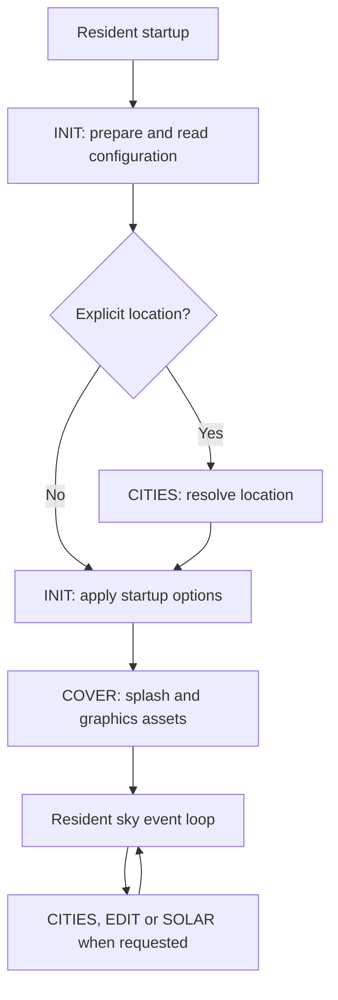

# SIDERA — Technical Reference

This document introduces the standalone SIDERA implementation to developers.
It explains the execution model, memory layout, rendering, data and build process.
For controls and command-line options, see the
[English user manual](../src/rom/sidera-manual-en.txt).

## Application and target

SIDERA is an offline sky observatory for RP6502-PICO and RP6502-EMU, written in C
and compiled with cc65. It displays the Sun, Moon, six planets and stars from all
88 constellations on a 640 × 480 VGA display. Users can change the observing
location, explore dates from 1900 through 2200, animate time, display daily paths
and inspect local rise/set times. A separate panel shows a schematic Solar System.

The deliverable is one `sidera.rp6502` file containing resident code, five code
overlays and the data resources. All astronomical calculations run on the 6502;
the application needs no network service. The RP6502 interface supplies console,
clock, filesystem and VGA access. The supported execution model is standalone.

## Source map

Start with `main.c`, then follow the relevant subsystem through this table.

| Source | Responsibility |
| --- | --- |
| [main.c](../src/main.c), [startup.c](../src/startup.c) | Resident application state, event loop, startup and overlay orchestration |
| [platform/](../src/platform/) | Console I/O, keyboard decoding, timing, VGA detection and monitor arguments |
| [overlays/](../src/overlays/) | Loader, linker layout, startup option and configuration parsing |
| [astro.c](../src/astro.c), [astro.h](../src/astro.h) | Fixed-point astronomy, date arithmetic and coordinate transforms |
| [graphics.c](../src/graphics.c), [constellations.c](../src/constellations.c) | Sky rendering, star projection, constellation caches and labels |
| [riseset.c](../src/riseset.c), [timezone.c](../src/timezone.c) | Local-day rise/set searches and time-zone lookup |
| [cities.c](../src/cities.c), [editor.c](../src/editor.c) | Location selection and location/date/zone editors |
| [files.c](../src/files.c), [cover.c](../src/cover.c) | Resource access, settings persistence and splash screen |
| [solar_math.c](../src/solar_math.c), [solar_draw.c](../src/solar_draw.c), [solar_labels.c](../src/solar_labels.c), [solar_ui.c](../src/solar_ui.c) | Solar System snapshot calculations, drawing, label placement and UI |
| [sidera.h](../src/sidera.h), [solar.h](../src/solar.h) | Shared declarations, graphics constants and XRAM layout |

File boundaries do not always match memory placement: segment pragmas and the
linker configuration determine which functions and data belong to each overlay.

## Startup and event loop

Startup first loads INIT to validate arguments, establish resource paths and read
settings. An explicit `/location` temporarily selects CITIES to resolve the
requested place. Resident startup code then selects INIT again to apply options.
The application opens its graphics resources, selects COVER for the splash and
initial graphics setup, and enters the sky view.



The program uses a single polling loop with incremental work. Keyboard input,
time updates, scene rendering, star transforms, daily paths and rise/set searches
share that loop. Persistent state lives mainly in globals and fixed-size buffers.

Expensive work is split into bounded steps. Scene rendering processes up to eight
work units or a two-tick budget per call; an individual unit completes atomically.
Star projection processes up to four stars per step, and rise/set search performs
at most one ephemeris evaluation per step. These budgets keep input responsive,
but are not hard real-time deadlines.

In LIVE mode, displayed clocks update each second, solar/lunar/planetary positions
refresh approximately every minute, and the star cache can be reused for up to
five minutes. SIM/PLAY advances by 15 minutes when the scheduled step is due and
the drawing and calculation jobs are ready. Its wall-clock speed therefore
depends on the workload. SIM/PAUSE holds the selected UTC instant.

Space cycles LIVE → SIM/PAUSE → SIM/PLAY → LIVE. Leaving LIVE freezes the
displayed time; returning reads the current system clock immediately. Shift+Right
selects the next 45-degree compass direction; Shift+Left selects the previous
one, including from bearings between compass directions. LCtrl+Left/Right narrows
or widens FOV by 10 degrees within 50–160. H and Shift+H have no action.

CITIES is a modal 590 × 322 pixel panel inside the sky plot, with a 5-pixel
outer margin and a 1-pixel white border. It displays 14 rows per page and keeps
all controls and messages inside the frame. Drawing preserves surrounding
bitmap pixels and header sprites; sky sprites overlapping the panel are hidden
until it closes. The main sky jobs remain suspended while selecting a city.

The X panel captures a snapshot of the displayed date. While open, it suspends
sky work and simulation advancement; LIVE clocks can still update. X closes the
panel and refreshes the sky, and Q exits. Panel state is not saved in settings.

## CPU memory and overlays

The CPU address layout is defined in
[overlay.cfg](../src/overlays/overlay.cfg). Addresses below are hexadecimal and
ranges include both endpoints.

| CPU address range | Use |
| --- | --- |
| `$0200` to below `$C800` | Resident code, constants and application data |
| `$C800–$DEFF` | One active overlay: 5,888 bytes shared by code, constants, initialized data and BSS |
| `$DF00–$DFFF` | Independent 256-byte scratch area, including a 224-byte configuration buffer |
| `$E000–$F6FF` | Currently unallocated by the linker; not an automatically available heap |
| `$F700–$FEFF` | 2,048-byte C software stack |

The five overlays serve distinct UI phases:

| Overlay | Contents |
| --- | --- |
| INIT | Startup options, configuration parsing and initial file handling |
| CITIES | Catalogue search and city selection |
| EDIT | Observer, UTC date and time-zone editors |
| COVER | Splash screen and initial VGA asset loading |
| SOLAR | Solar System calculations, drawing and labels |

A single ld65 link assigns all overlay execution addresses. The
[packer](../scripts/pack_overlays.py) produces the ROM resources and stamps the
resident image and overlay headers with a common eight-byte build identifier.
Overlays are specific to that linked build; they are not independently relocatable
plugins.

Each overlay resource starts with a 24-byte header containing the `SOV1` magic,
overlay ID, format version, payload length, BSS offset and length, build identifier
and payload CRC32. The [resident loader](../src/overlays/overlay.c) checks the
header and bounds, reads the payload, rejects trailing data, checks the checksum
and clears the overlay's BSS. A failed load invalidates the active overlay and
ends the application with a diagnostic. Selecting an already active overlay
does not reload it, so its local state survives that selection.

Resident code must control overlay changes. An overlay cannot replace the memory
containing its own executing code. Any state needed after replacement must live
outside the overlay window, and pointers into a replaced overlay are invalid.
Reloading an overlay resets its BSS. Breakpoints at shared addresses also depend
on which overlay is active.

`SIDERA_OVERLAYS` enables this placement and loader integration; tests can build
the same code without the overlay layout. It does not select a different operating
system. For measured sizes and available headroom, see the
[memory report](architecture.md) and the current build's linker map. In particular,
SOLAR has little spare space, so changes there require a size check.

## RP6502 interface and graphics memory

The [platform implementation](../src/platform/rp6502.c) reads and writes the RIA
console registers directly. The [keyboard decoder](../src/platform/key.c) handles
RIA character sequences for navigation, editing and modifier keys. Since these
sequences combine left and right Ctrl, startup also maps the 32-byte USB HID
keyboard bitmap at XRAM `$FFC0–$FFDF` using `xreg(0,0,0,address)`. Ctrl+horizontal
arrows read its modifier byte at `$FFDC`: left Ctrl must be down and right Ctrl
must be up to produce a FOV event. An unmapped keyboard or a generic Ctrl sequence
alone cannot change FOV. Cleanup unmaps the bitmap with address `$FFFF`.
See the [RIA keyboard interface](https://picocomputer.github.io/ria.html#keyboard).
The application requires VGA. Timing uses
125 ticks per second; elapsed-time comparisons use unsigned subtraction to allow
the 16-bit tick counter to wrap. Sleeps are busy waits. VGA detection and frame
synchronization use bounded waits.

The [monitor argument buffer](../src/platform/argv.c) is a resident 512-byte
`__argv_mem` implementation. It is compiled directly into the executable target,
because putting it only in a static library can allow cc65's default implementation
to satisfy the symbol instead. File access uses cc65 descriptors and operations
such as `open`, `read`, `lseek` and `close`.

VGA data lives in **XRAM, a separate address space from CPU RAM**. RIA address,
step and data registers provide access to it; assets can also be read directly
from a file into XRAM. Equal numeric addresses in the CPU and XRAM maps do not
refer to the same storage.

The 640 × 480 one-bit canvas occupies XRAM `$0000–$95FF` (38,400 bytes).
The rest holds the font, palettes, sprite images, VGA descriptors, star positions,
constellation metadata and edges, label storage and daily-path caches. The Moon
and projected star positions use double buffers. Consult
[sidera.h](../src/sidera.h) and [solar.h](../src/solar.h) before changing allocations;
the graphics and calculation subsystems share this address space.

The sky combines a monochrome canvas with coloured bitmap sprites and an affine
Moon sprite. Its projection maps azimuth and altitude linearly to screen
coordinates, wrapping azimuth around the view direction. Horizontal field of view
ranges from 50 to 160 degrees. The Moon selects one of 129 stored phase images
and rotates it to the calculated orientation. Sun and planet sprite ordering uses
geocentric distance; labels and daily paths require additional overlap handling.

The Solar System panel occupies 317 × 317 pixels. It shows all eight planets,
including Earth and Neptune, on eight fixed concentric circles. Directions follow
the calculated heliocentric positions, but circle radii are schematic rather than
an astronomical-unit scale. Its calculations and label placement are separate
from the main sky renderer.

## Astronomy, numeric units and time

Astronomy uses fixed-point arithmetic, lookup tables and integer intermediates.
The public types and conversion functions are in [astro.h](../src/astro.h).

| Quantity | Representation |
| --- | --- |
| Azimuth and orbital angles | One full turn is 65,536 units, with unsigned wraparound |
| Altitude angles | Signed units on the same angular scale |
| Trigonometric values and unit vectors | Signed Q14: 16,384 represents 1.0 |
| Observer latitude and longitude | Signed 32-bit integers in tenths of an arcsecond |
| Observer height | Integer metres |
| Planet/Sun distances used for ordering | Units of 1/1,024 AU |
| Application date | Gregorian UTC fields, years 1900–2200; no leap-second representation |

Custom date arithmetic uses 1999-12-31 as day zero and avoids depending on the
platform's `time_t` range for simulated dates. LIVE mode obtains the current UTC
date from the platform clock. Time-zone offsets affect local display and civil-day
boundaries, while the simulation instant remains UTC.

The Sun, Moon and planetary calculations adapt Paul Schlyter's low-precision
orbital model. The model and its simplifications are described in
[How to compute planetary positions](https://stjarnhimlen.se/comp/ppcomp.html).
SIDERA's implementation is in [astro.c](../src/astro.c); the snapshot panel's
heliocentric calculations are in [solar_math.c](../src/solar_math.c).

The sky calculation includes lunar perturbations, observer-dependent lunar
parallax and selected perturbations for Jupiter, Saturn and Uranus. Stars start
as J2000 unit vectors and use a cached matrix combining precession and the local
coordinate frame. The bundled catalogue contains 759 stars and 745 constellation
edges. Daily Sun/Moon paths contain 97 samples at 15-minute intervals across a UTC
day.

[Rise/set search](../src/riseset.c) instead follows the selected **local civil
day**, converting its boundaries through the time-zone data. It scans for horizon
crossings and refines brackets, accounting for the upper limb and standard
refraction. This distinction matters around daylight-saving changes. The UI also
handles days without a crossing and dates where a complete search is unavailable.

The implementation targets an interactive visual observatory. Regression tests
compare selected cases with stored reference data; their tolerances are not a
global accuracy guarantee over all dates and observers. See
[astronomy and rendering tests](tests.md) for coverage and reference provenance.

## Resources and settings

Resources are embedded in the ROM and opened through `ROM:` paths.

| Resource | Format and purpose |
| --- | --- |
| `sidera.dat` | `SIDERA5` header; font, palettes, Sun and Moon images, six sky-planet images, star/constellation data and splash assets |
| `sidera-solar.dat` | Additional Earth and Neptune images and palettes for the X panel |
| `sidera.cty` | `SIDCITY2` header and fixed-size city records with coordinates, height and time-zone ID |
| `sidera.tz` | `SIDTZ001` header, sorted zone index and UTC intervals carrying local offsets |
| `help`, `manual` | Startup help and the English user manual |
| `sidera-gpl.txt`, `sidera-notice.txt`, `sidera-sdk-license.txt` | GPLv3 text, project licensing scope and the retained SDK license |

The current city data contains 345 cities in 195 countries. The time-zone database
contains 598 zones, generated from the pinned tzdata package in
[src/data/](../src/data/). Zone names and offset intervals are searched in the file;
the whole database is not loaded into CPU RAM. Binary readers and generators must
agree on field sizes and byte order independently of the host compiler's C types.

`/assets` can override the main graphics resource. Asset, city and time-zone
lookup rules are implemented in [files.c](../src/files.c),
[startup file handling](../src/overlays/init_files.inc),
[cities.c](../src/cities.c) and [timezone.c](../src/timezone.c).
Other resources, including overlays, remain bundled with the application.

Settings are a small text file containing the observer coordinates, IANA zone
name, city label, view options and either LIVE mode or a UTC date. The default
path is `MSC0:/sidera.cfg`; `/config` overrides it. The emulator launch configuration
uses `SAVE:/sidera.cfg` for persistence.

Precedence is **defaults → saved configuration → startup options**. The last
repeated option wins. An explicit `/location` chooses a direction based on the
current local hour unless `/view` overrides it. Settings are written explicitly
with S, and a restored simulation date starts paused. Parsing uses a bounded
buffer and validates fields before applying the configuration.

## Building and validating changes

The build requires CMake 3.28+, Ninja, Python 3.12+, Git and a cc65 installation
with RP6502 support, including sim65. Native tests additionally need MSVC on
Windows or GCC on Linux. See the [README](../README.md) for environment setup,
WSL build directories and device launch instructions.

From the repository root:

```text
cmake --preset cc65/Debug
cmake --build --preset cc65/Debug
ctest --preset cc65/Debug
```

Use `cc65/Release` for the Release build. Both presets enable optimization;
Debug also emits debug information. The Debug ROM is written to
`build/cc65/debug/sidera/sidera.rp6502`, alongside linker and debug artifacts.
The [top-level CMake file](../CMakeLists.txt) defines the application;
[SideraOverlays.cmake](../cmake/SideraOverlays.cmake) integrates packing, and
[SideraTests.cmake](../cmake/SideraTests.cmake) integrates the tests.

Validation covers several distinct boundaries:

- Native C tests exercise calculations, settings, catalogues, rendering and
  application flow with host implementations of platform services.
- sim65 tests execute compiled 6502 code to catch target integer-width,
  arithmetic, parser and loader issues that a native build can miss.
- Image checks compare three sky views and three Solar System views with the
  committed reference images.
- ROM checks validate the packed overlays and resources. Emulator smoke tests
  exercise the complete ROM, keyboard interaction and saved settings.
- Generator checks reproduce the committed assets from local source data.

Hardware timing and device behaviour still require testing on PICO. For a code
change, run the applicable tests and inspect the linker map if memory placement
or size changed. The [test guide](tests.md) describes individual checks.

Ordinary builds use committed files from `src/rom/` and `src/tables/`. To verify
their reproducibility without replacing them:

```text
python scripts/regenerate.py --output build/generated --check
```

Generators use local inputs and write to `build/`. Updating committed assets is
a separate review step. Optional importers and reference-data download scripts
are not part of normal builds or tests.

## Further reading

- [English user manual](../src/rom/sidera-manual-en.txt): controls, startup options
  and observable behaviour.
- [Architecture and memory](architecture.md): detailed overlay sizes and graphics
  layout notes.
- [Tests](tests.md): validation procedures and reference data.
- [Provenance](provenance.md) and [source manifest](source-manifest.json): source
  history, data origins and extraction records.
- [License notices](../LICENSE-NOTICE.txt): retained author and third-party notices.
- [GPLv3](../LICENSE): the project's original code and documentation use
  `GPL-3.0-only`; third-party components retain their identified terms.
