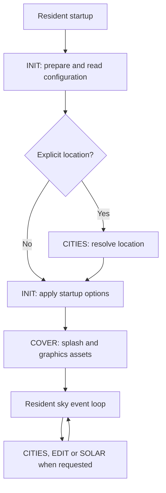

# SIDERA — Technical Reference

This document introduces the standalone SIDERA implementation to developers.
It explains the execution model, memory layout, rendering, data and build process.
For controls and command-line options, see the
[English user manual](../src/rom/sidera-manual-en.txt).

## Application and target

SIDERA is an offline sky observatory for RP6502-PICO, RP6502-EMU and RP6502-WEB, written in C
and compiled with cc65. It displays the Sun, Moon, six planets and stars from all
88 constellations on a 640 × 480 VGA display. Users can change the observing
location, explore dates from 1900 through 2200, animate time, display daily paths
and inspect local rise/set times. A separate panel shows a schematic Solar System.

The deliverable is one `sidera.rp6502` file containing resident code, six code
overlays and the data resources. All astronomical calculations run on the 6502;
the application needs no network service.

WEB wraps this same ROM with SDK player 0.43 in `web/sidera.zip`; there is no
separate C compilation or application platform layer for the browser. Its
`/config SAVE:/sidera.cfg` uses the player's `wojciechgw-sidera` IndexedDB database,
scoped to the page origin. The local launcher uses a fixed port for stable saves.
The RP6502 interface supplies console, clock, filesystem and VGA access.
The supported execution model is standalone.

## Source map

Start with `main.c`, then follow the relevant subsystem through this table.

| Source | Responsibility |
| --- | --- |
| [main.c](../src/main.c), [startup.c](../src/startup.c) | Resident application state, event loop, startup and overlay orchestration |
| [platform/](../src/platform/) | Console I/O, keyboard decoding, timing, VGA detection and monitor arguments |
| [overlays/](../src/overlays/) | Loader, linker layout, startup option and configuration parsing |
| [astro.c](../src/astro.c), [astro.h](../src/astro.h) | Fixed-point astronomy, date arithmetic and coordinate transforms |
| [graphics.c](../src/graphics.c), [constellations.c](../src/constellations.c) | Sky rendering, star projection, constellation caches and labels |
| [riseset.c](../src/riseset.c), [timezone.c](../src/timezone.c) | Local-day rise/set searches and time-zone lookup |
| [cities.c](../src/cities.c), [editor.c](../src/editor.c) | Location selection and location/date/zone editors |
| [world_map.c](../src/world_map.c) | Incremental geographic locator inside CITIES |
| [find.c](../src/find.c), [target.c](../src/target.c), [figure.c](../src/figure.c) | Object/constellation search, persistent selection and figure fitting |
| [files.c](../src/files.c), [cover.c](../src/cover.c) | Resource access, settings persistence and splash screen |
| [solar_math.c](../src/solar_math.c), [solar_draw.c](../src/solar_draw.c), [solar_labels.c](../src/solar_labels.c), [solar_ui.c](../src/solar_ui.c) | Solar System snapshot calculations, drawing, label placement and UI |
| [sidera.h](../src/sidera.h), [solar.h](../src/solar.h) | Shared declarations, graphics constants and XRAM layout |

File boundaries do not always match memory placement: segment pragmas and the
linker configuration determine which functions and data belong to each overlay.

## Startup and event loop

Startup first loads INIT to validate arguments, establish resource paths and read
settings. An explicit `/location` temporarily selects CITIES to resolve the
requested place. Resident startup code then selects INIT again to apply options.
The application opens its graphics resources, selects COVER for the splash and
initial graphics setup, and enters the sky view.



The program uses a single polling loop with incremental work. Keyboard input,
time updates, scene rendering, star transforms, daily paths and rise/set searches
share that loop. Persistent state lives mainly in globals and fixed-size buffers.

Immediately after the splash, startup draws the header and footer using the
loaded settings, before the first astronomical calculation. Sun/Moon AZ/ALT/LIT
fields show `...`; rise/set fields use the normal pending `..:..` format. Header
icons remain hidden. The first Sun/Moon result updates just those header fields
and reveals their correctly initialized icons before planet/star preparation.
Plot sprites stay hidden until the scene is ready, and rise/set results appear
when their incremental search finishes. This also applies without a saved preset.

Expensive work is split into bounded steps. Scene rendering processes up to eight
work units or a two-tick budget per call; an individual unit completes atomically.
Star projection processes up to four stars per step, and rise/set search performs
at most one ephemeris evaluation per step. These budgets keep input responsive,
but are not hard real-time deadlines.

In LIVE mode, displayed clocks update each second, solar/lunar/planetary positions
refresh approximately every minute, and the star cache can be reused for up to
five minutes. SIM/PLAY advances by five minutes when the previous drawing and
calculation jobs, including enabled daily paths, are complete. The minimum
start-to-start interval is 42 ticks (0.336 seconds); a busy step keeps its deadline
pending rather than restarting a one-second wait. It never catches up by skipping
instants. Actual speed depends on the workload. SIM/PAUSE holds the selected UTC
instant; manual +/- remains 15 minutes and pauses playback.

The loop sleeps only when background work is finished. Keyboard polling remains
between bounded job batches. For time updates, a new catalogue is prepared before the scene is
redrawn, avoiding an extra redraw of the previous star positions. The header and
body sprites are presented with that scene. Projection preparation also precedes
clearing the bitmap, so the old plot remains visible longer.

C follows the same preparation rule when enabling stars or changing their mode:
the selected footer option and Working indicator update immediately, while the
existing plot stays visible until pending star positions are ready. Further C
presses replace the pending mode; one final scene uses the latest selection.
Switching back to mode 0 removes the general star layer without waiting for its
calculation; a selected constellation remains visible and still needs its angles.

G/T/P/C update their footer highlights before starting chart work. The footer
caches the four visible on/off states and the last message. Only a changed label
is repainted; changing between enabled G or C modes requires no footer writes.
A changed message clears and redraws only its own line, including removal of
old trailing text. Unchanged LIVE/SIM refreshes perform no footer bitmap writes.
Canvas setup and Ctrl+L invalidate the whole footer; clearing its rows (including
editor entry) invalidates the affected content so the next call restores it.

Manual navigation has priority over this preparation: arrows, compass steps
and FOV changes start drawing immediately from the last complete star angles,
with exact projections calculated on demand. View/FOV fields update without
redrawing the rest of the header or footer. Pending star calculation resumes
after that drawing; its completion requests a fresh scene for the new instant.
This preserves the inactive buffer and prevents auto-repeat from continually
restarting a full-catalogue projection prepass. Complete rendering is still
incremental; prompt feedback does not mean the whole plot finishes immediately.

After star calculation, its inactive XRAM angle buffer temporarily holds exact
screen coordinates. Stars, edges and labels reuse them. `cs_begin()` invalidates
this cache before reusing the buffer for the next catalogue; pan, elevation and
FOV changes invalidate screen coordinates too. There is no interpolation.
Grid pixel rows are cached until elevation or FOV changes. Projection scaling
uses unsigned shifts with an explicit sign to retain signed division's truncation
toward zero without cc65's general 32-bit division routine.

Space enters SIM/PAUSE from LIVE, then toggles SIM/PAUSE and SIM/PLAY.
Leaving LIVE freezes the displayed time; only N returns to LIVE and reads
the current system clock immediately. Shift+Right selects the next 45-degree
compass direction; Shift+Left selects the previous
one, including from bearings between compass directions. LCtrl+Left/Right narrows
or widens FOV by 10 degrees within 50–160. H and Shift+H have no action.

CITIES is a modal 640 × 409 pixel panel from below the header to the bottom of
the screen, covering the sky plot, both compasses, side scales and footer.
It has no outer margin, a 1-pixel white border and 22 rows per page. Only city
controls and messages appear inside the frame. Selection clears notes so sky
work descriptions appear immediately. Drawing preserves the header and its sprites; sky sprites are
hidden until it closes. The main sky jobs remain suspended while selecting a
city. Closing clears the panel and invalidates the axes and footer so the plot,
scales, compasses and sky shortcuts are restored, including daylight inversion.

The left-hand list has 22 rows, clipped to 52 characters. Its last row starts at
y=425, above the unchanged message and keyboard-help rows. A 300x150 north-up, equirectangular world map
occupies the upper-right corner with a five-pixel inset from the frame. The
selected city's geographic continent is filled white; other land remains in
outline. A red 5x5 cross, one pixel thick, is centered on the city without a backing.
Nine detail rows below the map start at x=334, y=240, spaced by 14 pixels:
`city:`, `country:`, `continent:`, `LAT:`, `LON:`, `AMSL:`, `timezone:`, `UTC:`, `time:`. Labels are
left-aligned; values start at x=400, one space after the longest label.
The full names, UTC offset and seasonal status describe the highlighted city at
the frozen displayed UTC instant (`moment`), in LIVE or SIM. Historical offsets
include seconds when nonzero. LAT/LON use the shared DMS formatter with 0.1 arcsec
precision and N/S/E/W; AMSL is in metres. The former bottom coordinate line is
removed, and result-count clearing touches only the right side so it cannot
erase the two extra list rows. No matches clears all nine rows and removes the
highlight and marker. Missing zone data shows `unavailable` without preventing
city browsing. `tz_details()` runs in CITIES and does not change the active
zone, observer or resident conversion cache. Enter still applies the city.
Moves within the same zone preserve its three detail rows without zone reads
or bitmap writes; a full panel clear invalidates this cache.
List clearing runs in resident CODE and search/truncation helpers in HIGH;
their CITIES state is accessed only while that overlay is loaded.
Each pass streams three raster rows; a move within the same region updates only
the sprite coordinates, leaving the map bitmap intact. The map is optional at runtime:
an I/O failure does not prevent selecting a city.

Seven conventional geographic regions are assigned from coordinates by
`scripts/world_regions.py`, independently of country membership. Europe/Asia
uses a simplified Urals–Caspian–Caucasus–Turkish Straits division. Oceania includes
Hawaii and New Guinea; Greenland is North American, Madeira/Canaries African.
The three region bits occupy bits 4..6 of the existing SIDCITY2 role byte, leaving
the default/capital/seat bits intact. Untagged legacy catalogues use a coarse
lookup raster from the map resource. These assignments serve a schematic locator.

Ctrl+F (either Ctrl key) opens FIND; plain F is inactive. The panel uses the
same bounds as CITIES and 20 rows. The 855-entry offline catalogue
contains eight Solar System bodies, the existing 759 stars and 88 constellations,
indexed back to their unchanged vectors and figures. Search matches a case-insensitive substring of names,
Bayer/Flamsteed designations, HIP or HD identifiers from two characters onward.
Constellations match Latin names and three-letter abbreviations. An exact name
or constellation abbreviation is placed first, ahead of partial matches.
The selected row shows exact AZ/ALT and Above/Below horizon for the frozen date.
The 312 px list on the left has five fixed columns: Type, HIP, HD, Designation
and Name. Types use Sun/Moon/Pl/St/Con. Empty cells stay blank, long values use an
ellipsis, and selection inverts the whole row.
The primary designation is Bayer's when available, otherwise Flamsteed's;
constellations use their three-letter code. Full names, all aliases and positions
appear on the right of the 20-row list. All original aliases remain searchable.
On a finished page, arrow navigation XORs the old and new row rectangles, with
800 bitmap writes and no catalogue reads. Page clearing, painting and figure
calculations accept new navigation. Details wait for 250 ms without navigation,
then calculate the latest object and paint one detail line per polling step.
Enter bypasses the delay but never accepts a stale position.
Queries replace an unfinished scan; Esc cancels, and Enter during work waits for
the latest result. Scanning, clearing old results and painting yield to input.

For single objects, Enter sets bearing/elevation, preserves FOV, and enables P or C1 if necessary.
LIVE first resynchronizes the time, then centres the freshly computed position.
In C4 the selected star is drawn in addition to the restricted groups. A resident
marker follows its changing position without moving the camera. Cancellation
preserves the previous selection; replacing it or exiting ends that selection.
Turning its layer off hides the marker. Selection is not part of saved settings.
The view range, CLI validation and settings now allow elevation -90..+90 degrees.
The selected star is omitted from the normal cached star pass and rendered once
at its exact current position with its catalogue size. Its marker replaces the
usual navigation/planet label to avoid duplicate labels.

For constellations, `figure.c` finds the shortest azimuth arc and altitude bounds
of all figure endpoints, centres the view and fits both dimensions with an 8 px
margin plus angular rounding allowance. FOV is rounded up to 10-degree steps,
within 50..160 degrees; a message reports an insufficient maximum. Previews
calculate two endpoints per polling step for the frozen date and report whether
the figure is above, below or crossing the horizon. After selection, the fit uses
the completed angular cache for the current sky time. Selected stars, solid lines
and an inverse figure label are drawn independently of C, including C0 and C4.
The mode remains unchanged. LIVE refreshes the angular cache at each displayed
time while a figure is selected; the camera moves only on selection.

The S panel captures a snapshot of the displayed date. While open, it suspends
sky work and simulation advancement; LIVE clocks can still update. Esc closes the
panel and refreshes the sky. Ctrl+Q (either Ctrl key) exits globally, including
from panels and editors; plain Q and Esc in the sky view do not exit.
Panel state is not saved in settings. S opens SOLAR; X has no action.
Ctrl+S and Ctrl+R (either Ctrl key) save/reload settings only in the main sky view
and are ignored in panels and editors. Ctrl+R uses the same `config_path`, restores
all fields and refreshes the sky, axes, paths and header. Saved LIVE mode reads
the current clock; a saved simulation date enters SIM/PAUSE. The selected FIND
target remains active. Missing/invalid files, read errors and unavailable LIVE
clocks leave settings unchanged. Success messages are `[INFO] Configuration saved`
and `[INFO] Configuration reloaded`; failures use `[!] Failed to save configuration`
and `[!] Failed to reload configuration`.
These four result messages expire after five seconds (625 platform ticks).
Repeated actions restart the timer even when the text is unchanged. The resident
loop checks elapsed unsigned ticks without blocking; replacement notes cancel
the old timer. Expiration clears the result and refreshes the sky footer while
preserving G/C descriptions. Modal panels retain ownership of their pixels.
Resident main selects INIT before `config_reload()`. The shared parser validates
the entire file and, for reloads of LIVE, a clock snapshot before applying fields.
`gx_footer()` resides in HIGH to leave room for resident input handling.
The three footer rows at y=441, 451 and 461 have 8 px
side margins, with gaps differing by at most one pixel within each row. The
first starts two empty scanlines below the compass and contains
`Arrows/+Shift/+Ctrl: view/NWSE/FOV`, `Ctrl+S/+R: safe/reload config`,
`Ctrl+F: find object` and `Ctrl+Q: quit`, with 20 px gaps; FIND appears only here.
The second groups N, Space, +/-,
[/], D and Z, with 48 px gaps. The third contains `L: location`, `K: cities & locations`,
`S: Solar system`, `P: planets`, `T: paths`, `G: grid` and `C: constellations`,
with 15 px gaps. The C highlight stays inside the right margin. Notes start at x=8, y=472, aligned with Arrows.
For active G/C modes, the colon becomes a 1 px white vertical line at x=481/538
from its upper dot (y=462) through the last screen row (y=479). Mode 0 restores
the colon. Note-row clearing restores the lower line segments; shortcut-row
clearing restores the full lines. Unchanged states cause no bitmap writes.
On that row, persistent white-on-black labels start at x=485 for G and x=542
for C, aligned with the highlighted fields above. G1/G2/G3 read `scale`, `cross`,
`net`; C1/C2/C3/C4 read `stars`, `charts`, `charts & names`,
`navigational`. G0/C0 are blank. Ordinary notes must end before these fields.
Padded labels erase longer previous text. Each field caches its mode separately;
note-row clearing invalidates both caches, while unchanged modes cause no writes.
The busy label occupies x=8, y=472 whenever sky work is pending and `note` is empty.
Stages use `[INFO] Calculating Sun & Moon...`, `Calculating planets...`,
`Calculating stars...`, `Calculating rise/set...`, `Calculating paths...` and
`Drawing sky...`, each with the INFO prefix. The pending stars/rise-set/paths
bitmask produces combined text such as `Calculating stars, rise/set & paths...`;
completed or disabled tasks disappear without oscillation between work batches.
gx_status selects a GX_WORK stage
before executing it. Value 1 preserves the current stage (or uses the generic
Working label if none has been selected); 0 ends work. Switching stages never
restarts the Moon delay or phase cycle. No detailed status text is drawn in panels.
It has no timeout. Save/reload results take priority for their five-second
interval; afterward the latest stage returns only if work is still pending.
The footer caches the displayed string, keeping the busy label separate from
`note`. The 78-character field is clipped and padded to x=8..475; changed messages
overwrite only these cells, never clearing or rewriting G/C labels and lines.
A full row clear is reserved for restoration after footer invalidation.
All nonempty messages use black glyphs on white across the entire 78-cell field,
including its padding. Empty messages restore a black field. Changing between
empty and nonempty redraws all cells; same-background transitions retain the
partial-update optimization. G/C keep their existing rendering.
An unchanged work set reuses its cached description without formatting. Changed
messages redraw only through the last differing character of the padded field.
Successful CITIES/L/Z changes clear notes instead of installing a save reminder.
Modal panels own their
pixels and suppress footer updates until they close. Header redraws only update
the right-aligned LIVE/SIM status; status updates clear x=424..639, y=0..8.
An additional 32x32 unscaled Moon at (3,33) indicates sustained work, including
CITIES, FIND, SOLAR and editor processing. Idle input is not work. After 63
125 Hz ticks, twenty original phase/orientation frames run over 250 ticks.
The cycle grows from new to full with the light on the right, then wanes with
the light on the left, with a fixed 15-degree counterclockwise tilt throughout.
The inverse 8.8 affine transform uses sine 66 and cosine 247 about (15.5,15.5),
without changing the real Moon sprites. Its timing handles the 16-bit tick wrap; unchanged frames
perform no image reads or sprite writes. Completed work hides it immediately.
The affine Mode 4 descriptor occupies XRAM $E6E0..$E6F3, beyond FIND and SOLAR
scratch, on foreground plane 2 clipped to y=33..64. The inactive 2048-byte Moon
buffer supplies its RGB pixels. Real Moon phase changes hide and invalidate
the indicator before exchanging buffers, preserving both real Moon sprites.
Ordinary animation uploads retain the visible descriptor and read the next
phase into the animation image without first hiding or clearing it. Only the
initial frame is published from a hidden state. Failed reads suppress it until the next work
period without replacing notes. Resident gx_wait_step is serviced by the work
loop, text/clear batches, city record scans and solar orbit drawing; it never
runs in an interrupt or changes sky/date state. sky_start, gx_canvas and
gx_header_pending reside in COVER and run only once while that overlay is loaded.
Scene clearing stops before `FOOTER_TOP` (441); editors clear from that row
to the screen bottom so no shortcut fragments remain.
FOV still requires physical left Ctrl despite the compact footer description.

## CPU memory and overlays

The CPU address layout is defined in
[overlay.cfg](../src/overlays/overlay.cfg). Addresses below are hexadecimal and
ranges include both endpoints.

| CPU address range | Use |
| --- | --- |
| `$0200` to below `$C800` | Resident code, constants and application data |
| `$C800–$DEFF` | One active overlay: 5,888 bytes shared by code, constants, initialized data and BSS |
| `$DF00–$DFFF` | Independent 256-byte scratch area, including a 224-byte configuration buffer |
| `$E000–$F6FF` | Resident HIGH target/figure code and initialized workspace; unused tail is not a heap |
| `$F700–$FEFF` | 2,048-byte C software stack |

The six overlays serve distinct UI phases:

| Overlay | Contents |
| --- | --- |
| INIT | Startup options, configuration parsing and initial file handling |
| CITIES | Catalogue search and city selection |
| EDIT | Observer, UTC date and time-zone editors |
| COVER | sky_start orchestration, splash, initial VGA assets, gx_canvas and gx_header_pending |
| SOLAR | Solar System calculations, drawing and labels |
| FIND | Incremental catalogue search, results and exact selected-object details |

A single ld65 link assigns all overlay execution addresses. The
[packer](../scripts/pack_overlays.py) produces the ROM resources and stamps the
both resident images and overlay headers with a common eight-byte build identifier.
Overlays are specific to that linked build; they are not independently relocatable
plugins.

Each overlay resource starts with a 24-byte header containing the `SOV1` magic,
overlay ID, format version, payload length, BSS offset and length, build identifier
and payload CRC32. The [resident loader](../src/overlays/overlay.c) checks the
header and bounds, reads the payload, rejects trailing data, checks the checksum
and clears the overlay's BSS. A failed load invalidates the active overlay and
ends the application with a diagnostic. Selecting an already active overlay
does not reload it, so its local state survives that selection.

Resident code must control overlay changes. An overlay cannot replace the memory
containing its own executing code. Any state needed after replacement must live
outside the overlay window, and pointers into a replaced overlay are invalid.
Reloading an overlay resets its BSS. Breakpoints at shared addresses also depend
on which overlay is active.

`SIDERA_OVERLAYS` enables this placement and loader integration; tests can build
the same code without the overlay layout. It does not select a different operating
system. For measured sizes and available headroom, see the
[memory report](architecture.md) and the current build's linker map. In particular,
SOLAR has little spare space, so changes there require a size check.

## RP6502 interface and graphics memory

The [platform implementation](../src/platform/rp6502.c) reads and writes the RIA
console registers directly. The [keyboard decoder](../src/platform/key.c) handles
RIA character sequences for navigation, editing and modifier keys. Since these
sequences combine left and right Ctrl, startup also maps the 32-byte USB HID
keyboard bitmap at XRAM `$FFC0–$FFDF` using `xreg(0,0,0,address)`. Ctrl+horizontal
arrows read its modifier byte at `$FFDC`: left Ctrl must be down and right Ctrl
must be up to produce a FOV event. An unmapped keyboard or a generic Ctrl sequence
alone cannot change FOV. Cleanup unmaps the bitmap with address `$FFFF`.
See the [RIA keyboard interface](https://picocomputer.github.io/ria.html#keyboard).
The application requires VGA. Timing uses
125 ticks per second; elapsed-time comparisons use unsigned subtraction to allow
the 16-bit tick counter to wrap. Sleeps are busy waits. VGA detection and frame
synchronization use bounded waits.

The [monitor argument buffer](../src/platform/argv.c) is a resident 512-byte
`__argv_mem` implementation. It is compiled directly into the executable target,
because putting it only in a static library can allow cc65's default implementation
to satisfy the symbol instead. File access uses cc65 descriptors and operations
such as `open`, `read`, `lseek` and `close`.

VGA data lives in **XRAM, a separate address space from CPU RAM**. RIA address,
step and data registers provide access to it; assets can also be read directly
from a file into XRAM. Equal numeric addresses in the CPU and XRAM maps do not
refer to the same storage.

The 640 × 480 one-bit canvas occupies XRAM `$0000–$95FF` (38,400 bytes).
The rest holds the font, palettes, sprite images, VGA descriptors, star positions,
constellation metadata and edges, label storage and daily-path caches. The Moon
and star angles use double buffers; the inactive star buffer also serves as the
screen-coordinate cache between catalogue calculations. Consult
[sidera.h](../src/sidera.h) and [solar.h](../src/solar.h) before changing allocations;
the graphics and calculation subsystems share this address space.

The sky combines a monochrome canvas with coloured bitmap sprites and an affine
Moon sprite. Its projection maps azimuth and altitude linearly to screen
coordinates, wrapping azimuth around the view direction. Horizontal field of view
ranges from 50 to 160 degrees. The Moon selects one of 129 stored phase images
and rotates it to the calculated orientation. Sun and planet sprite ordering uses
geocentric distance; labels and daily paths require additional overlap handling.

Perimeter scales are preserved independently of the plot interior. The upper
and lower compasses change with bearing or FOV; the side scales change with
elevation or FOV. Grid visibility also controls the upper and side scales.
LIVE and SIM/PLAY updates leave all unchanged margins in place, except for the
lower compass's daylight style. Its full-width band (rows 424–438, below the V)
uses black ticks and directions on white from the displayed Sun Rise minute
(inclusive) to Set (exclusive). At night it uses white on black. Polar UP/DOWN
and civil days with just one crossing are supported; pending, stale or unavailable
event results use the normal dark band. A style transition XORs only that band,
including when time runs backward, without clearing the plot or the V.
Direction glyphs occupy rows 431–437, leaving one empty row after the ticks
and one row of background below the letters.
Clearing uses
masked writes at the plot edges because margin and plot pixels share bytes.
Left scale ticks inside the plot and the interior horizon are restored on each
scene. Regions become valid only after drawing finishes, so interrupted view
changes cannot leave an incomplete scale cached. Full bitmap clears and Ctrl+L
invalidate the affected regions. The interior grid still redraws normally.

The Solar System panel occupies the same 640 × 409 pixels as CITIES
(x=0..639, y=71..479), preserving the header, with a one-pixel frame.
Its diagram is centred at (320, 280), with orbit radii of
39, 55, 71, 87, 109, 131, 154 and 176 pixels; sprite and text sizes are unchanged.
The SOLAR sprite list also covers scanlines 416..479, while sky sprites retain
their original clip. Closing clears the panel and invalidates axes and footer.
It shows all eight planets,
including Earth and Neptune, on eight fixed concentric circles. Directions follow
the calculated heliocentric positions, but circle radii are schematic rather than
an astronomical-unit scale. Its calculations and label placement are separate
from the main sky renderer.

## Astronomy, numeric units and time

Astronomy uses fixed-point arithmetic, lookup tables and integer intermediates.
The public types and conversion functions are in [astro.h](../src/astro.h).

| Quantity | Representation |
| --- | --- |
| Azimuth and orbital angles | One full turn is 65,536 units, with unsigned wraparound |
| Altitude angles | Signed units on the same angular scale |
| Trigonometric values and unit vectors | Signed Q14: 16,384 represents 1.0 |
| Observer latitude and longitude | Signed 32-bit integers in tenths of an arcsecond |
| Observer height | Integer metres |
| Planet/Sun distances used for ordering | Units of 1/1,024 AU |
| Application date | Gregorian UTC fields, years 1900–2200; no leap-second representation |

Custom date arithmetic uses 1999-12-31 as day zero and avoids depending on the
platform's `time_t` range for simulated dates. LIVE mode obtains the current UTC
date from the platform clock. Time-zone offsets affect local display and civil-day
boundaries, while the simulation instant remains UTC.

The Sun, Moon and planetary calculations adapt Paul Schlyter's low-precision
orbital model. The model and its simplifications are described in
[How to compute planetary positions](https://stjarnhimlen.se/comp/ppcomp.html).
SIDERA's implementation is in [astro.c](../src/astro.c); the snapshot panel's
heliocentric calculations are in [solar_math.c](../src/solar_math.c).

The sky calculation includes lunar perturbations, observer-dependent lunar
parallax and selected perturbations for Jupiter, Saturn and Uranus. Stars start
as J2000 unit vectors and use a cached matrix combining precession and the local
coordinate frame. The bundled catalogue contains 759 stars and 745 constellation
edges. Daily Sun/Moon paths contain 97 samples at 15-minute intervals across a UTC
day.

[Rise/set search](../src/riseset.c) instead follows the selected **local civil
day**, converting its boundaries through the time-zone data. It scans for horizon
crossings and refines brackets, accounting for the upper limb and standard
refraction. This distinction matters around daylight-saving changes. The UI also
handles days without a crossing and dates where a complete search is unavailable.

The integer hot paths preserve the original rounding: Q14 multiplication biases
negative products before an unsigned shift and a 16-bit cast; sine interpolation
uses a nonnegative 16-bit product (at most 101 * 63) and a six-bit shift. Kepler
iteration stops early only when its integer correction is exactly zero. These
changes leave the orbital model and the 97-point path sampling unchanged. The
12-byte month-length table resides in HIGH to keep the resident image within its
memory limits.

Resident astronomy caches retain the unrounded daily bases for five Sun/Moon
orbital elements, obliquity sine/cosine and solar eccentricity, keyed by UTC day.
The fractional-day contribution is still evaluated for every requested instant
before the original angle rounding. A separate observer cache keys all latitude,
longitude and altitude fields and retains the WGS84 terms used for parallax.
Sidereal sine/cosine are rebuilt per call and shared by the bodies at that instant.
Sun/Moon, rise/set, planet and star-frame calls can alternate dates and observers;
each public entry prepares the state it uses. These helpers are deliberately
non-reentrant, matching the single resident polling loop. The lunar inclination
sine/cosine are exact precomputed lookup results, checked against the tables.
Complete rise/set samples are not reused by the 97-point path cache: their local
civil-day coverage and adaptive sampling differ from the UTC path grid.

The implementation targets an interactive visual observatory. Regression tests
compare selected cases with stored reference data; their tolerances are not a
global accuracy guarantee over all dates and observers. See
[astronomy and rendering tests](tests.md) for coverage and reference provenance.

## Resources and settings

Resources are embedded in the ROM and opened through `ROM:` paths.

| Resource | Format and purpose |
| --- | --- |
| `sidera.dat` | `SIDERA5` header; font, palettes, Sun and Moon images, six sky-planet images, star/constellation data and splash assets |
| `sidera.find` | `SIDFIND3` header and 855 fixed 256-byte records: object index, label, complete searchable aliases and a padded 52-character table row |
| `sidera-solar.dat` | Additional Earth and Neptune images and palettes for the S panel |
| `sidera.cty` | `SIDCITY2` header and fixed-size city records with coordinates, height and time-zone ID |
| `sidera.map` | `SIDMAP1` header, eight 300x150 map variants in shifted 39-byte rows, then a geographic lookup raster; 91816 bytes |
| `sidera.tz` | `SIDTZ001` header with `DST1` extension, sorted zone index, UTC offset intervals and seasonal classifications |
| `help`, `manual` | Startup help and the English user manual |
| `sidera-gpl.txt`, `sidera-notice.txt`, `sidera-sdk-license.txt` | GPLv3 text, project licensing scope and the retained SDK license |

The catalogue contains 345 cities in 195 countries, 22 Antarctic research
stations grouped under Antarctica [AQ], and 21 Special locations [XX].
The latter appear first: four reference points, seven continental summits,
Mont Blanc and Mount Kosciuszko alternatives, and eight landmarks.
Their sources, reference-point definitions and zones are in
[locations.json](../src/data/locations.json). The original four points and
Mount Vinson use the agreed Etc/UTC convention; Everest uses Asia/Kathmandu.
Other additions use local IANA zones. XX is an internal group with no bare-code
CLI default. Names, XX/Name and country-code/Name select exact locations;
bare country codes retain their existing defaults. Details use location:
and the actual country (or - for the original four). Shared summits list both
countries; Mont Blanc's FR/IT assignment does not resolve boundary depictions.
Longyearbyen belongs to Norway and uses Arctic/Longyearbyen.
The reviewed COMNAP map snapshot,
field sources and exclusions are in [stations.json](../src/data/stations.json).
COMNAP data has separate educational/non-commercial terms in
[sidera-stations-license.txt](../src/rom/sidera-stations-license.txt).
Stations precede cities, with Arctowski the AQ default; operator country codes
and full names are searchable. Bare country CLI defaults still select cities,
except AQ. Both AQ/Station and OperatorCode/Station accept the short bare name.

SIDCITY2 remains a 16-byte header followed by 96-byte records. Flag bit 3 marks
a station; bits 0..2 and 4..6 retain their meanings. Station country bytes 3..13
hold `Antarctica\0`; unused country padding bytes 14..42 hold NUL-terminated
operator aliases, e.g. `|FR France|IT Italy`. Byte 42 must remain zero. The name
at 43..82 includes the display suffix `[FR/IT]`; lookup strips it only in its
temporary record, then rereads the matched record before applying it. Ordinary
city country padding stays zero. Older readers can display and select stations
as AQ places, but cannot use operator search or the station label.
Bit 7 marks a special location and makes region zero explicitly mean no
continent, rather than the legacy geographic fallback. `world_select()` receives
the high nibble: 8..15 designate explicit regions 0..7, with a marker even for
zero. Ordinary zero still uses the map lookup. Region indices returned to the
detail panel and used to read map rasters are always 0..7. Unknown/no continent
is displayed as `-`. Special records store the actual country name (or `-`) in bytes 3..31,
NUL-terminated, and country search aliases such as `|NP|CN` in bytes 32..42.
The display name includes `[NP/CN]`; exact lookup strips this suffix as for
stations. List rows and group-name searches use `Special locations`, independently
of the country field. Full country names and both country codes remain searchable.

CITIES uses 248 bytes of shared CPU scratch at $DF00: record[96], query[40],
line[112]. Configuration I/O only borrows this area outside CITIES. Resident
helpers may access these buffers only while that overlay is loaded.

The time-zone database
contains 598 zones, generated from the pinned tzdata package in
[src/data/](../src/data/). Zone names and offset intervals are searched in the file;
the whole database is not loaded into CPU RAM. Binary readers and generators must
agree on field sizes and byte order independently of the host compiler's C types.

The `DST1` extension occupies header bytes 12..15. Each zone index still points
to `n` 12-byte little-endian records (signed 32-bit day, second, UTC offset),
followed immediately by `n` classification bytes: 0 = `standard (no DST)`,
1 = `standard (winter)`, 2 = `daylight (summer)`. Classification uses IANA data
for the selected local calendar year; zero-offset changes in the DST flag and
year boundaries are retained when they affect the displayed status. Negative
DST conventions are normalized: the lower-offset winter period is standard,
the zero-DST summer period is daylight. A year with no daylight period is
classified as no DST. These are civil-time labels, not astronomical seasons.
Aliases share tables. Older readers can still use the unchanged offset records;
new readers show `unavailable` for seasonal status if `DST1` is absent or unreadable.

`/assets` can override the main graphics resource. Asset, city and time-zone
lookup rules are implemented in [files.c](../src/files.c),
[startup file handling](../src/overlays/init_files.inc),
[cities.c](../src/cities.c) and [timezone.c](../src/timezone.c).
Other resources, including overlays, remain bundled with the application.

Settings are a small text file containing the observer coordinates, IANA zone
name, city label, view options and either LIVE mode or a UTC date. The default
path is `MSC0:/sidera.cfg`; `/config` overrides it. The emulator launch configuration
uses `SAVE:/sidera.cfg` for persistence.

Precedence is **defaults → saved configuration → startup options**. The last
repeated option wins. An explicit `/location` chooses a direction based on the
current local hour unless `/view` overrides it. Settings are written explicitly
with S, and a restored simulation date starts paused. Parsing uses a bounded
buffer and validates fields before applying the configuration.

## Building and validating changes

The build requires CMake 3.28+, Ninja, Python 3.12+, Git and a cc65 installation
with RP6502 support, including sim65. Builds require Windows; native tests
additionally need MSVC.
See the [README](../README.md) for environment setup and device launch instructions.

From the repository root:

```text
cmake --preset cc65/Debug
cmake --build --preset cc65/Debug
ctest --preset cc65/Debug
```

Use `cc65/Release` for the Release build. Both presets enable optimization;
Debug also emits debug information. The Debug ROM is written to
`build/cc65/debug/sidera/sidera.rp6502`, alongside linker and debug artifacts.
The [top-level CMake file](../CMakeLists.txt) defines the application;
[SideraOverlays.cmake](../cmake/SideraOverlays.cmake) integrates packing, and
[SideraTests.cmake](../cmake/SideraTests.cmake) integrates the tests.

Validation covers several distinct boundaries:

- Native C tests exercise calculations, settings, catalogues, rendering and
  application flow with host implementations of platform services.
- sim65 tests execute compiled 6502 code to catch target integer-width,
  arithmetic, parser and loader issues that a native build can miss.
- Image checks compare three sky views and three Solar System views with the
  committed reference images.
- ROM checks validate the packed overlays and resources. Emulator smoke tests
  exercise the complete ROM, keyboard interaction and saved settings.
- Generator checks reproduce the committed assets from local source data.

Hardware timing and device behaviour still require testing on PICO. For a code
change, run the applicable tests and inspect the linker map if memory placement
or size changed. The [test guide](tests.md) describes individual checks.

Ordinary builds use committed files from `src/rom/` and `src/tables/`. To verify
their reproducibility without replacing them:

```text
python scripts/regenerate.py --output build/generated --check
```

Generators use local inputs and write to `build/`. Updating committed assets is
a separate review step. Optional importers and reference-data download scripts
are not part of normal builds or tests.

## Further reading

- [English user manual](../src/rom/sidera-manual-en.txt): controls, startup options
  and observable behaviour.
- [Architecture and memory](architecture.md): detailed overlay sizes and graphics
  layout notes.
- [Tests](tests.md): validation procedures and reference data.
- [Provenance](provenance.md) and [source manifest](source-manifest.json): source
  history, data origins and extraction records.
- [License notices](../LICENSE-NOTICE.txt): retained author and third-party notices.
- [GPLv3](../LICENSE): the project's original code and documentation use
  `GPL-3.0-only`; third-party components retain their identified terms.
